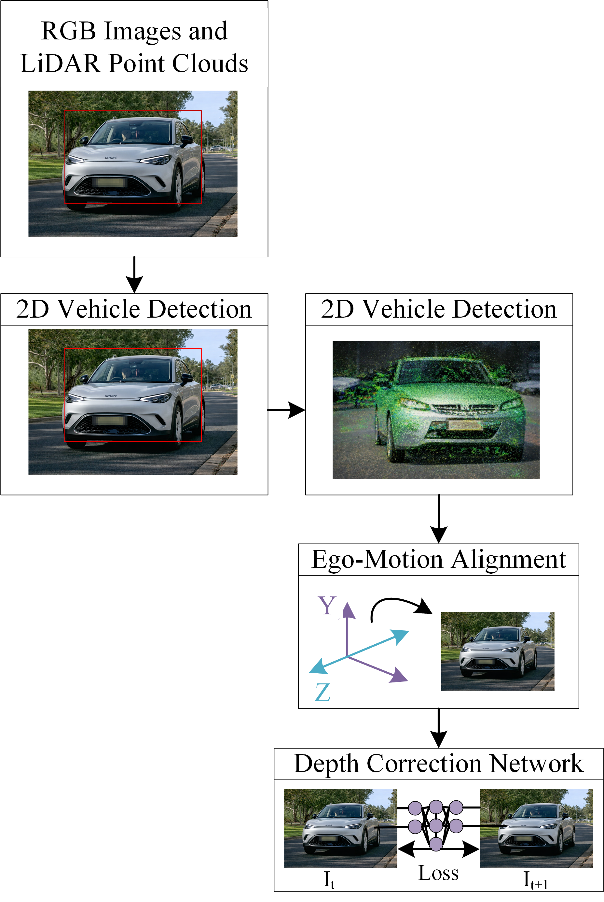

# Self-Supervised Depth Correction via Temporal 3D Consistency under Ego-Motion

<p>We proposed an object-level, uncertainty-aware self-supervised refinement framework that learns adaptive 3D corrections under ego-motion using temporal geometric consistency, without requiring 3D bounding-box supervision. </p>

---
<div align="center">
  
</div>


# Table of Contents

<a href= "#Overview">Overview</a><br>
<a href= "#Prerequisites">Prerequisites</a><br>
<a href= "#Getting Started">Getting Started</a><br>
<a href= "#Author & Contact">Author & Contact</a>
---
<h2><a class = "anchor" id="Overview"></a>Prerequisites</h2>

```
1. Install Python >= 3.13.5
2. Install Detectron2
3. Install os, re, cv2, argparse, random
4. Install numpy 
5. Install glob
6. install tqdm, typing
```


---
  <h2><a class = "anchor" id="Author & Contact"></a>Author & Contact </h2>
  Falak Niaz <br>
  Department of Electronic Engineering, Kookmin University Seoul South Korea <br>
  https://wireless.kookmin.ac.kr/ <br>
  Email: falakbhai300@gmail.com <br>
  Phone: +821059559661
   
